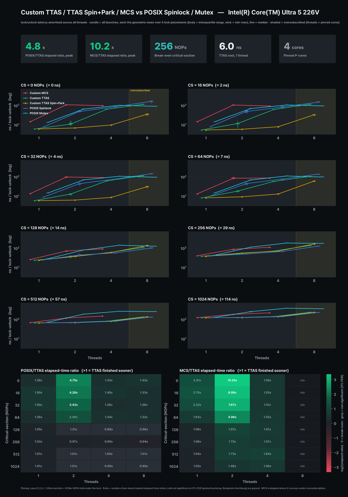

# Spinlock Implementation & Performance Test

This project provides custom spinlocks using architecture-specific inline assembly (x86-64 and aarch64) and compares them head-to-head with the POSIX spinlock (`pthread_spin_lock`) and the default POSIX mutex (`pthread_mutex_lock`). Three disciplines are exposed, each named for its algorithm and its wait policy: `spin_lock_ttas` (test-and-test-and-set with exponential backoff, pure spin), `spin_lock_ttas_park` (the same loop, but it sleeps 1 us per failed CAS once the backoff cap is reached) and `spin_lock_mcs` (an MCS queue lock, also usable with caller-supplied nodes). The benchmark allows granular control over threading, iteration counts, workload simulation, CPU pinning, timer slack, and which contenders run, via command-line arguments.

## Supported Platforms
- **Architecture**: x86-64 and aarch64. Each acquire/release primitive is emitted as architecture-specific inline assembly selected at compile time (`#if defined(__x86_64__)` / `__aarch64__`); any other target stops with a `#error`.
  - **x86-64**: `pause` spin hint, `lock cmpxchgl` acquire, and a plain store release — sufficient under the strong x86-TSO memory model. The TTAS backoff is timed with `rdtsc`, calibrated once against `CLOCK_MONOTONIC`.
  - **aarch64**: `yield` spin hint and an `stlr` store-release (a plain store is *not* a release on the weakly-ordered aarch64 memory model). The TTAS backoff is timed with the generic timer (`cntvct_el0`, frequency from `cntfrq_el0`). The acquire is chosen at compile time:
    - **v8.1 LSE** (`__ARM_FEATURE_ATOMICS` defined): a single-instruction `casa` (load-acquire compare-and-swap). With no exclusive monitor to lose, it has no retry loop and scales far better under heavy contention. Enabled when the toolchain targets an LSE-capable CPU (e.g. `-march=armv8.1-a` or `-march=armv8-a+lse`).
    - **Baseline v8.0** (`-march=armv8-a`, no LSE): an `ldaxr`/`stlxr` load-acquire exclusive CAS retry loop with `clrex` on mismatch — the portable fallback used when LSE is unavailable.
- **Lock disciplines** (all on x86-64 and aarch64; a NULL lock pointer faults, it is not silently ignored):
  - **`spin_lock_ttas`** / **`spin_unlock_ttas`** — test-and-test-and-set with exponential backoff between failed CAS attempts, timed in nanoseconds (`-m`..`-M`, default 32..1,024 ns); each wait is drawn from the upper half of the current window, so waiters do not retry in lockstep. Timing the wait keeps it the same on every core type: a pause costs 10.1 ns on a P-core and 21.9 ns on an E-core of the test host, so a cap counted in pauses would differ by 2.2x between them. Pure spin: a waiter never leaves the CPU. An uncontended acquire is a single CAS.
  - **`spin_lock_ttas_park`** — the same loop on the same `spinlock_ttas_t` (same init, same unlock), but once the backoff cap is reached every further failed CAS calls `nanosleep(1 us)`. Linux rounds that sleep up by the thread's timer slack (`/proc/self/timerslack_ns`, 50 us by default; real-time scheduling classes get zero slack), so a parked waiter is away for ~50 us while the holder re-acquires unopposed: throughput over fairness, and a policy the benchmark's `-S` flag makes visible.
  - **`spin_lock_mcs`** / **`spin_unlock_mcs`** — an MCS queue lock (tail swap via `xchg` / LSE `swpal` / LL-SC, hand-off via `stlr` / release store). Each waiter spins on its own cache line, so it is FIFO-fair and storm-free, at the cost of a cache-line transfer per hand-off; it convoys under oversubscription (a preempted successor stalls the whole queue). These single-argument wrappers use a per-thread node defined once in `spinlock.c` (`spin_mcs_thread_local_node`), so a lock taken in one translation unit may be released in another; they still must not nest, because one node can sit in only one queue at a time (the debug build aborts on a nested wrapper call). **`spin_lock_mcs_node(lock, node)`** / **`spin_unlock_mcs_node(lock, node)`** take an explicit, cache-line-aligned `mcs_node_t` and have neither limit:
    ```c
    spinlock_mcs_t lock;            /* spin_init_mcs(&lock) once */
    mcs_node_t node;                /* one per thread per held lock */
    spin_lock_mcs_node(&lock, &node);
    /* critical section */
    spin_unlock_mcs_node(&lock, &node);
    ```
- **Core types**: on parts with more than one core class (Intel P/E, Arm big.LITTLE) the harness pins workers to the fastest class unless `-C` says otherwise. It reads `cpu_capacity` (else `cpufreq/cpuinfo_max_freq`) for every allowed CPU, keeps those within 80% of the highest value, and fills one hardware thread per physical core first. Homogeneous parts are not pinned.
- **OS**: Linux
- **Compilers**: GCC or Clang (Standard: `gnu99`)
- **Build Systems**: GNU Make (≥ 4.3) and CMake (≥ 3.16)
- **Build Modes** (all three carry the same warning set, `-Wall -Wextra -Wshadow -Wformat=2 -Wstrict-prototypes -Wmissing-prototypes -Wpointer-arith -Wcast-qual -Wwrite-strings -Wvla -Wundef -Wnull-dereference -Wimplicit-fallthrough -Wdouble-promotion -Wconversion -Wsign-conversion`, and the same compile-time hardening, `-fstack-protector-strong -fstack-clash-protection -fcf-protection=full` (`-mbranch-protection=standard` on aarch64) `-fPIE`; release and debug also link with `-pie -Wl,-z,relro,-z,now,-z,noexecstack`):
  - **Release**: `-O3 -D_FORTIFY_SOURCE=3 -fno-omit-frame-pointer -fasynchronous-unwind-tables` — optimized for benchmarking with frame pointers and unwind tables preserved for `perf` and flame graphs. The hardening flags touch no instruction in the lock hot paths; an A/B run of old flags against new flags on this host stayed inside run-to-run noise.
  - **Debug**: `-O0 -g3 -DSPINLOCK_DEBUG -fno-inline -fno-inline-functions -fno-optimize-sibling-calls -rdynamic` — every `static inline` helper resolves to a real call frame so `uftrace`, `gdb`, `strace`, and `perf` can step into each function. `SPINLOCK_DEBUG` compiles in misuse checks that abort at the offending call: `spin_unlock_ttas` on a lock that is not held, `spin_unlock_mcs_node` on an empty queue, and a nested `spin_lock_mcs` wrapper call. Each check is a plain load on a path the caller already owns and never touches the lock protocol.
  - **Sanitize**: `-O1 -g -DSPINLOCK_DEBUG -ftls-model=local-exec -fsanitize=address,undefined -fno-sanitize-recover=all` — the correctness suite under ASan + UBSan, built by `make` when the toolchain has the sanitizer runtimes and run by `make sanitize`. `-ftls-model=local-exec` avoids a GCC 16 false positive (see [Validators](#validators)).
- **Warnings**: no errors under either compiler. The only warnings are intentional unused ones: `-Wunused-parameter` on the check suite's shared-signature lock callbacks and `-Wunused-function` on `report_skip` in `SPINLOCK_DEBUG` builds. They are never silenced (no `(void)` casts, unused attributes or `-Wno-*` flags); every other warning is fixed.
- **Code Style**: LLVM-based `.clang-format` — 4-space indent, right-aligned pointers, Allman function braces, K&R control flow, 100-column soft limit. C files are ordered: preprocessor, types (`typedef`/`struct`/`union`/`enum`), variables, functions; a table of function pointers (`g_contenders`) follows the functions it references.

## Build Instructions

Both build systems write each program to `bin/<arch>-linux-<compiler>/<config>/` (`<arch>` from `$(CC) -dumpmachine`, `<compiler>` is `gcc` or `clang`), so GCC, Clang and cross builds coexist. GCC is the default.

### Make

```bash
make                  # everything in parallel: all binaries + compile_commands.json, tags, cscope.out
make -j4              # cap the parallel jobs (same as make JOBS=4); -j1 builds serially
make CC=clang         # the same set built with Clang, into bin/x86_64-linux-clang/
# or build a single configuration:
make release          # bin/<arch>-linux-<compiler>/release/{spinlock_test,spinlock_check}
make debug            # bin/<arch>-linux-<compiler>/debug/{spinlock_test,spinlock_check}
make index            # compile_commands.json + tags + cscope.out only

make check            # run the correctness suite on the release and debug check binaries
make sanitize         # build the suite with ASan + UBSan and run it
make lsp-check        # let clangd parse every file and print its errors
make tidy             # clang-tidy over every translation unit
make clean            # remove bin/ (and a CMake build/); keep indexes and tool output
make distclean        # clean + indexes, caches and every debugger / profiler artifact
```

- Without `-j`, make runs `nproc` jobs (GNU Make ≥ 4.3); `-jN` or `JOBS=N` overrides it.
- Several goals run one at a time in the given order, so `make clean all` is safe.
- `make all` never runs tests: concurrent stress tests oversubscribe the cores (three check binaries together ran past 120 s, versus 2–3 s alone).
- Toolchains without sanitizer runtimes (e.g. `aarch64-linux-gnu-gcc`) skip the sanitize build with a notice.
- Each binary records its build command and compiler version in `.<program>.cmd`; changing `CC`, `ARCH_CFLAGS` or any flag rebuilds only the affected binaries.

### Editor integration: clangd, ctags, cscope

`make all` (or `make index`) writes three files into the source root, all ignored by git:

- **`compile_commands.json`** — one entry per translation unit with the exact release flags. clangd reads it and parses each `.c` file, and each header through the `.c` that includes it, as `gnu99` C for the compiler's target. Without this file clangd falls back to a bare `clang <file>`, which treats a `.h` as Objective-C++ and knows neither the standard nor `_GNU_SOURCE`: that fallback is where the spurious errors and missed real ones came from. The Makefile regenerates the file whenever the content would differ, so `make CC=aarch64-linux-gnu-gcc compdb` flips clangd to the aarch64 branch of `spinlock.h` (clangd reads the target from the compiler name) and `make compdb` flips it back.
- **`tags`** — Universal Ctags with prototypes, externs and qualified names (`--kinds-C=+px --fields=+iaSn --extras=+q`) over the project sources only.
- **`cscope.out`** (plus `cscope.files`, `cscope.in.out`, `cscope.po.out`) — built in kernel mode (`-k`) from the same file list, so it indexes the project and not `/usr/include`.

The checked-in **`.clangd`** adds `-ferror-limit=0`, strips the GCC-only flags clang would reject, keeps the include cleaner on (`UnusedIncludes: Strict`, with `MissingIncludes` off because glibc's transitive includes make it guess wrong), and enables a clang-tidy set (`bugprone-*`, `cert-*`, `clang-analyzer-*`, `misc-*`, `performance-*`, `portability-*`, `readability-*`) minus the checks that are noise on this code base: `cert-err33-c` (unchecked `printf` return values), `concurrency-mt-unsafe` (`getopt`/`strtol`/`exit` from a single-threaded `main`), `readability-use-concise-preprocessor-directives` (the `#if defined(...)` chains that keep `#elif` legible), `bugprone-reserved-identifier` (`_GNU_SOURCE`) and the magic-number / identifier-length / cognitive-complexity style checks. **`.clang-tidy`** mirrors that list so `make tidy` and the editor agree. clang-tidy 23 reports only `portability-no-assembler` (inline asm), `readability-trailing-comma` and `misc-unused-parameters` (the lock callbacks). `make lsp-check` runs `clangd --check` over every file with the database in place and fails on any error (`clangd --check` prints errors only; warnings show in the editor).

CMake users get the same indexes from `cmake --build build --target index`, which copies `build/compile_commands.json` to the source root and runs ctags and cscope there.

### CMake

```bash
cmake -S . -B build
cmake --build build -j
ctest --test-dir build          # runs both check binaries

# or with Clang:
CC=clang cmake -S . -B build
cmake --build build -j
```

CMake writes the release and debug programs to the same `bin/<arch>-linux-<compiler>/{release,debug}/` folders as Make. The sanitize build is Makefile-only.

### aarch64

On an aarch64 host, `make` and `cmake` work unchanged. To cross-build from an x86 host, just point the build at the cross compiler: the Makefile reads the target triple from `$(CC) -dumpmachine`, so an aarch64 compiler automatically gets the v8.0 baseline `-march=armv8-a` (the portable `ldaxr`/`stlxr` LL/SC atomics). Run the result under QEMU:

```bash
make CC=aarch64-linux-gnu-gcc
qemu-aarch64 -L /usr/aarch64-linux-gnu ./bin/aarch64-linux-gcc/release/spinlock_test -t 4 -l 0 -i 100000
```

To emit the single-instruction LSE atomics (`casa` acquire, `swpal`/`casl` for the MCS queue) instead of the LL/SC fallback, target an LSE-capable architecture via `ARCH_CFLAGS` (Make) or `-DARCH_LSE=ON` (CMake):

```bash
make CC=aarch64-linux-gnu-gcc ARCH_CFLAGS='-march=armv8.1-a'   # or -mcpu=neoverse-n1
cmake -S . -B build -DCMAKE_C_COMPILER=aarch64-linux-gnu-gcc -DARCH_LSE=ON && cmake --build build -j
```

Both land in `bin/aarch64-linux-gcc/`; switching between them rebuilds automatically.

A fully static binary (no sysroot needed to run under QEMU) can be built directly:

```bash
aarch64-linux-gnu-gcc -O3 -std=gnu99 -Wall -Wextra -static -march=armv8.1-a \
    spinlock.c spinlock_test.c main.c -o spinlock_test_arm64_lse -pthread
```

Confirm which path was compiled in by disassembling: `casa`/`swpal` means the LSE path, `ldaxr`/`stlxr` means the LL/SC fallback.

### Artifacts (in `bin/<arch>-linux-<compiler>/`)

| Folder | Programs | Built by |
| :--- | :--- | :--- |
| `release/` | `spinlock_test`, `spinlock_check` | `make`, `make release` |
| `debug/` | `spinlock_test`, `spinlock_check` | `make`, `make debug` |
| `sanitize/` | `spinlock_check` | `make`, `make sanitize` |

- `release/spinlock_test` — **release build**, used for benchmarking and the headline numbers below.
- `debug/spinlock_test` — **debug build**, used with `uftrace`, `gdb`, `strace`, `perf`, and other analysis tools. Inlining is fully suppressed and `-rdynamic` exposes all symbols, so every helper appears as a real call frame.
- `release/spinlock_check` / `debug/spinlock_check` — the **correctness suite** (see [Stability & Sanity Checks](#stability--sanity-checks)) built with the release and the debug flags; `make check` runs both. `SPINLOCK_CHECK_ITERATIONS=<n>` shrinks the contended passes, for example under valgrind.
- `sanitize/spinlock_check` — the suite under AddressSanitizer + UndefinedBehaviorSanitizer, run by `make sanitize`.

### Source layout
- `spinlock.h` — the three lock disciplines, header-only apart from the definitions below.
- `spinlock.c` — the backoff window (`g_conf_spin_min` / `g_conf_spin_max`, defaults `SPINLOCK_DEFAULT_SPIN_MIN` / `SPINLOCK_DEFAULT_SPIN_MAX`) and the thread-local MCS node behind the single-argument wrappers. Link it into every program that uses the header.
- `spinlock_test.h` / `spinlock_test.c` / `main.c` — the benchmark harness behind the `bench_*` API.
- `spinlock_check.c` — the correctness suite.

## Usage & Options

Run the binary directly from the command line. If no arguments are provided, default values are used. The examples use the release build of the default toolchain on x86-64; substitute your own `<arch>-linux-<compiler>` folder.

```bash
./bin/x86_64-linux-gcc/release/spinlock_test [options]
```

### Command-Line Arguments

| Option | Argument | Description | Default |
| :--- | :--- | :--- | :--- |
| `-t` | `<threads>` | **Thread Count**: Number of concurrent worker threads to spawn. | `4` |
| `-i` | `<iters>` | **Iterations**: Number of critical section entries per thread. | `1,000,000` |
| `-l` | `<loops>` | **Workload**: Number of `nop` loop iterations inside the critical section (simulates load). | ≈ 50 ns |
| `-o` | `<loops>` | **Outside work**: Number of `nop` loop iterations each thread runs after releasing the lock and before asking again, so the lock is contended as in real code rather than saturated. `0` is the saturated stress test that `test_bench.py` runs. | ≈ 150 ns |
| `-m` | `<ns>` | **Min Backoff**: First backoff window after a failed CAS, in nanoseconds. | `32` |
| `-M` | `<ns>` | **Max Backoff**: Cap of the doubling backoff window, in nanoseconds. `ttas_park` sleeps 1 us per failed CAS once the cap is reached. | `1,024` |
| `-C` | `<cpulist>` | **Pin**: Bind workers round-robin to these cores (e.g. `0-3` or `0,2,4`), or `none`. Without `-C`, P/E and big.LITTLE parts pin to the fastest core class (see [Supported Platforms](#supported-platforms)) and homogeneous parts run unpinned. | fastest core class |
| `-K` | `<locks>` | **Contenders**: Comma-separated subset of `ttas,ttas_park,pspin,pmutex,mcs`, run in the given order. Drop `mcs` at thread counts that oversubscribe the cores, where the queue lock convoys. | all five |
| `-S` | `<ns>` | **Timer slack**: `prctl(PR_SET_TIMERSLACK)` for the process before the workers start; it stretches every `nanosleep` of `ttas_park`. `0` restores the kernel default, the smallest value is `1`. The effective value is printed in the header. | inherited (50,000 ns) |
| `-F` | `<format>` | **Output**: `text`, or `csv` with one row per contender and page (what `test_bench.py` reads). | `text` |
| `-P` | `<pages>` | **Placement**: Run every contender once per listed page of a private pool (e.g. `0-3` or `2,0,2`, pages `0`–`63`). Each page holds the four locks and the shared counter at the same offsets, so the list sets their physical placement. | `0` |
| `-h` | N/A | **Help**: Display usage information and exit. | N/A |

The header prints the measured cost of one workload loop iteration (`NOP Cost`, taken at startup on the first pinned core after a 50 ms warm-up) and shows `-l` and `-o` in NOPs and nanoseconds. Both defaults are sized from that cost, so they mean the same time on any core. Each contender prints a **`Fairness`** line: the earliest and latest per-thread completion time measured from the start barrier, and their ratio (`min/max`; `1.00` means every thread finished together, a small value means one thread ran through while the others waited). A **`Switches`** line counts the workers' involuntary (preemption) and voluntary context switches, and a **`Placement`** line names the page. The process exits with status 1 if any contender's atomic count is wrong.

### Execution Examples

#### 1. Default Run
4 threads, 50 ns inside the lock and 150 ns outside it: heavy but not saturated contention. On P/E or big.LITTLE parts the workers run on the fastest core class.
```bash
./bin/x86_64-linux-gcc/release/spinlock_test
```

#### 2. High Contention Test
Saturate the lock: 8 threads, an empty critical section and no work outside the lock.
```bash
./bin/x86_64-linux-gcc/release/spinlock_test -t 8 -l 0 -o 0
```

#### 3. Long Critical Section Test
Simulate a scenario where the lock is held for a longer duration (10,000 nops), which narrows the gap between the spinlocks as raw acquire cost is amortized over the critical section.
```bash
./bin/x86_64-linux-gcc/release/spinlock_test -l 10000
```

#### 4. Tuning Backoff Algorithm
Set the backoff window in nanoseconds, here 64 ns doubling up to 4 us. The window is timed, so the same values hold on P-cores, E-cores and aarch64 cores.
```bash
./bin/x86_64-linux-gcc/release/spinlock_test -m 64 -M 4096
```

#### 5. Controlled Run (pinning + contender selection)
Pin explicitly (here the four P-cores, which is also the default on this host) and compare only the TTAS lock against POSIX (dropping the MCS queue lock):
```bash
./bin/x86_64-linux-gcc/release/spinlock_test -t 4 -C 0-3 -K ttas,pspin
```

#### 6. Timer Slack
Run the parking TTAS and the POSIX mutex with a 1 ns timer slack, so `nanosleep(1 us)` returns after ~2 us instead of ~50 us:
```bash
./bin/x86_64-linux-gcc/release/spinlock_test -t 4 -C 0-3 -l 0 -o 0 -S 1 -K ttas_park,pmutex
```

## Profiling & Tracing the Debug Build

The debug build (`./bin/x86_64-linux-gcc/debug/spinlock_test`) suppresses inlining and ships full debug info, so every `static inline` helper resolves to a real call frame. Common workflows:

```bash
# Function-level user-space trace (uftrace)
uftrace ./bin/x86_64-linux-gcc/debug/spinlock_test -t 8 -l 0 -i 100000

# Hot-path sampling with perf (DWARF call graph)
perf record -F 999 --call-graph dwarf ./bin/x86_64-linux-gcc/debug/spinlock_test -t 8 -l 0 -i 100000
perf report

# Single-step into spin_lock_ttas under gdb
gdb -ex 'b spin_lock_ttas' --args ./bin/x86_64-linux-gcc/debug/spinlock_test -t 2 -l 0 -i 1000

# Syscall summary
strace -c ./bin/x86_64-linux-gcc/debug/spinlock_test -t 4 -l 0 -i 100000

# Valgrind: memory errors, thread races, cache profile
valgrind --tool=memcheck --leak-check=full ./bin/x86_64-linux-gcc/debug/spinlock_test -t 2 -l 0 -i 1000
valgrind --tool=helgrind                    ./bin/x86_64-linux-gcc/debug/spinlock_test -t 4 -l 0 -i 1000
valgrind --tool=drd                         ./bin/x86_64-linux-gcc/debug/spinlock_test -t 4 -l 0 -i 1000
valgrind --tool=cachegrind                  ./bin/x86_64-linux-gcc/debug/spinlock_test -t 2 -l 500 -i 10000
```

All commands above run unchanged on an aarch64 host. To drive a cross-built aarch64 binary from an x86 host, wrap it in QEMU's gdbstub and attach the cross debugger:

```bash
make CC=aarch64-linux-gnu-gcc debug
qemu-aarch64 -L /usr/aarch64-linux-gnu -g 1234 ./bin/aarch64-linux-gcc/debug/spinlock_test -t 2 -l 0 -i 1000 &
aarch64-linux-gnu-gdb -ex 'set sysroot /usr/aarch64-linux-gnu' -ex 'target remote :1234' \
    -ex 'b spin_lock_ttas' ./bin/aarch64-linux-gcc/debug/spinlock_test
```

Use `make distclean` to scrub every debugger / profiler / tracer artifact (cores, valgrind dumps, perf.data, uftrace.data, `__pycache__`, CMake residue, …) on top of `make clean`'s build-only sweep.

The release build (`./bin/<arch>-linux-gcc/release/spinlock_test`, or whatever `--binary` names) is what `test_bench.py` exercises and what produces the headline numbers below.

## Benchmark Results
*Test environment: Intel Core Ultra 5 226V (4 P-cores @ 4.5 GHz + 4 E-cores @ 3.5 GHz), Arch Linux, kernel `7.2.14-arch1-1`, GCC 16.2.1 release build (`-O3`), default timer slack 50,000 ns (`/proc/self/timerslack_ns`). Workers pinned to the four P-cores (`-C 0-3`). Each number is the median over 5 launches (3 for the longer critical section), each launch the geometric mean of 4 placement pages (`-P 0-3`), 1,000,000 iterations per thread and `-o 0` unless stated. `ns/acq` is elapsed time divided by the total number of acquisitions, and `min/max` is the median ratio of the earliest to the latest thread completion. The measured NOP cost is 0.111 ns.*

**What the harness rewards.** Each thread performs a fixed number of acquisitions and the elapsed time is the wall time until the *last* thread finishes; there is no fairness term. On the same four cores a contended hand-off costs every lock about the same, because the lock word (or the MCS flag) has to move between cores: ≈ 85–105 ns per acquisition here for the POSIX spinlock, the POSIX mutex and MCS. A lock that finishes several times sooner is doing different work: its waiters stay away from the lock while one thread re-acquires uncontended at ≈ 9 ns. The `min/max` column exposes it; `1.00` means the lock was handed around evenly, `0.4–0.6` means one thread ran through while the others waited.

### Default run (`-t 4`: ≈ 50 ns inside the lock, ≈ 150 ns outside it)

| Lock | Elapsed (ms) | ns/acq | min/max |
| :--- | ---: | ---: | ---: |
| `ttas` | 716.5 | 179.1 | 0.93 |
| `ttas_park` | 634.1 | 158.5 | 0.85 |
| `pspin` | 859.2 | 214.8 | 0.93 |
| `pmutex` | 1,081.6 | 270.4 | 0.97 |
| `mcs` | 612.8 | 153.2 | 1.00 |

With work outside the lock the lock is busy most of the time but not saturated, so the hand-off decides. MCS is fastest: each release passes the lock to one known waiter. `ttas` is 1.20x ahead of `pthread_spin_lock` at the same fairness, `ttas_park` gains by parking waiters, and the mutex pays a futex wake per contended hand-off.

### 4 threads, empty critical section (`-t 4 -l 0 -o 0`)

| Lock | Elapsed (ms) | ns/acq | min/max |
| :--- | ---: | ---: | ---: |
| `ttas` (timed backoff, 32–1,024 ns) | 256.6 | 64.2 | 0.95 |
| `ttas_park` (spin, then 1 us park) | 38.7 | 9.7 | 0.63 |
| `pspin` (`pthread_spin_lock`) | 337.4 | 84.4 | 0.66 |
| `pmutex` (`pthread_mutex_lock`) | 415.1 | 103.8 | 0.95 |
| `mcs` | 402.4 | 100.6 | 1.00 |

`ttas` hands the lock around (0.95) and is still 1.3x faster than `pthread_spin_lock`, whose waiters never back off and keep bouncing the lock line: that is the benefit of TTAS with backoff. `ttas_park` is 7x faster than `ttas` only because its waiters sleep ≈ 50 us while one thread runs through (0.63).

### Timer slack (`-S`)

`ttas_park` sleeps 1 us per failed CAS once the backoff cap is reached, and Linux rounds `nanosleep` up by the timer slack. Note that `prctl(PR_SET_TIMERSLACK, 0)` *restores the kernel default* (the header shows `Timer Slack : 50000 ns` for `-S 0`); `-S 1` is the smallest slack, and real-time scheduling classes get zero slack without any flag.

| `-t 4 -l 0 -o 0`, lock | slack 50,000 ns | slack 1,000 ns | slack 1 ns |
| :--- | ---: | ---: | ---: |
| `ttas_park` elapsed (ms) / min/max | 37.8 / 0.65 | 99.3 / 0.84 | 128.1 / 0.86 |
| `ttas` elapsed (ms) / min/max (no sleep, reference) | 258.4 / 0.95 | 255.4 / 0.94 | 260.1 / 0.94 |

With the 1 us backoff cap the park is the whole wait, and the slack sets its length: over 2,000 samples on a P-core, `nanosleep(1 us)` returns after a median of 52.0 us at the default slack, 3.1 us at `-S 1000` and 1.9 us at `-S 1`. Shortening it brings the parked waiters back sooner, and `ttas_park` goes from 37.8 ms to 128.1 ms (3.4x) with no code change, while the pure-spin `ttas` stays at ≈ 258 ms. A `ttas_park` result is therefore a property of the kernel's timer slack as much as of the lock; report `-S` (or the header's `Timer Slack`) with it.

### Backoff cap (`-M`, 4 threads, empty critical section)

| `-M` (ns) | `ttas` elapsed (ms) / ns/acq / min/max | `ttas_park` elapsed (ms) / min/max | `pspin` elapsed (ms) / min/max |
| :--- | ---: | ---: | ---: |
| 256 | 324.0 / 81.0 / 0.94 | 34.9 / 0.75 | 373.8 / 0.68 |
| 1,024 (default) | 256.3 / 64.1 / 0.94 | 37.8 / 0.71 | 366.7 / 0.70 |
| 8,192 | 95.0 / 23.7 / 0.68 | 43.2 / 0.73 | 326.5 / 0.66 |
| 65,536 | 40.9 / 10.2 / 0.51 | 42.7 / 0.57 | 355.1 / 0.69 |
| 167,000 | 37.5 / 9.4 / 0.49 | 37.4 / 0.55 | 370.6 / 0.68 |

Up to a microsecond `ttas` hands the lock around and beats `pthread_spin_lock`; from ≈ 8 us it becomes a serialiser, several times "faster" at min/max 0.5–0.7. The previous default, 16,000 pauses (≈ 167 us on a P-core, ≈ 351 us on an E-core), sat at that end. In the sweep below the 1 us cap is 3–6% behind `pthread_spin_lock` at 256 NOPs with 2–8 threads and ahead of it or level everywhere else.

### Oversubscription on the four P-cores (`-t 8` and `-t 16`, `-l 0 -o 0`)

| Lock | 8 threads: elapsed (ms) | ns/acq | min/max | 16 threads: elapsed (ms) | ns/acq | min/max |
| :--- | ---: | ---: | ---: | ---: | ---: | ---: |
| `ttas` | 955.0 | 119.4 | 0.93 | 3,490.8 | 218.2 | 0.87 |
| `ttas_park` | 288.7 | 36.1 | 0.75 | 7,200.5 | 450.0 | 0.81 |
| `pspin` | 1,362.5 | 170.3 | 0.66 | 4,997.5 | 312.3 | 0.61 |
| `pmutex` | 729.8 | 91.2 | 0.96 | 1,603.9 | 100.2 | 0.88 |
| `mcs` (10,000 / 5,000 iterations per thread) | 50,469 | 630,865 | 1.00 | 98,398 | 1,229,978 | 0.00 |

Once threads outnumber cores the lock holder gets preempted. The POSIX spinlock's waiters spin through their whole timeslice (170 → 312 ns/acq); the mutex parks them in the kernel and stays at ≈ 100 ns/acq. `ttas` stays fair and ahead of `pspin` but behind the mutex. `ttas_park` is the fastest at 8 threads and the slowest at 16. MCS collapses: a preempted successor stalls the whole queue for a scheduler quantum, ≈ 0.6 ms per acquisition at 8 threads and 1.2 ms at 16 (one launch, one page each), which is why the sweep drops it above the core budget.

### A longer critical section (`-t 4 -l 4096 -o 0`, ≈ 0.46 us held)

| Lock | 1 thread (ms) | 4 threads (ms) | min/max |
| :--- | ---: | ---: | ---: |
| `ttas` | 468.4 | 2,085.3 | 0.41 |
| `ttas_park` | 468.3 | 2,079.7 | 0.40 |
| `pspin` | 470.5 | 2,103.9 | 0.46 |
| `pmutex` | 473.8 | 3,416.2 | 0.98 |
| `mcs` | 470.0 | 2,624.0 | 1.00 |

The critical section dominates: 4 × 468 ms = 1,873 ms of serialised work is the floor. The three spinlocks land within 11–12% of it and their ordering is gone (`ttas`/`pspin` = 0.99x). MCS adds ≈ 186 ns per hand-off, the mutex ≈ 380 ns: with a 0.46 us hold every acquisition is contended, so every mutex hand-off goes through a futex wake. The spinlocks' min/max stays at 0.4–0.5 because a released lock goes to whichever waiter sees it first.

### Uncontended cost (`-t 1 -l 0 -o 0`, ns per lock/unlock pair)

`ttas` 6.1 · `ttas_park` 6.1 · `pspin` 7.6 · `pmutex` 13.2 · `mcs` 14.5. Single-threaded, the custom TTAS lock is 1.6 ns ahead of `pthread_spin_lock`.

### Core types and contention levels

*Each cell: 7 launches × 4 pages, 300,000 iterations per thread, workers pinned to the listed CPUs (the mixed set alternates P- and E-cores). Work inside and outside the lock is sized in nanoseconds with each class's NOP cost (0.1115 ns on a P-core, 0.1432 ns on an E-core); the mixed set uses the P-core size, so the same work takes 1.28x longer on its E-cores. Ratios are paired per launch, and **bold** marks a ratio significant at a 5% false discovery rate over all 45 cells.*

`pspin`/`ttas` elapsed-time ratio (>1 = `ttas` finished sooner):

| Inside / outside the lock (ns) | P-cores 0-3, 2 thr | P-cores 0-3, 4 thr | P-cores 0-3, 8 thr | E-cores 4-7, 2 thr | E-cores 4-7, 4 thr | E-cores 4-7, 8 thr | P and E mixed, 2 thr | P and E mixed, 4 thr | P and E mixed, 8 thr |
| :--- | ---: | ---: | ---: | ---: | ---: | ---: | ---: | ---: | ---: |
| 0 / 0 (saturated) | **4.15x** | **1.33x** | **1.50x** | 0.79x | 0.83x | 0.91x | 1.21x | 1.03x | **1.05x** |
| 50 / 0 (saturated) | **1.02x** | 1.01x | 1.00x | 1.00x | **1.03x** | 1.02x | **0.97x** | 1.00x | 1.03x |
| 50 / 150 (default) | **1.01x** | **1.21x** | **1.29x** | **1.01x** | **0.98x** | **1.07x** | **0.81x** | 1.03x | **0.75x** |
| 50 / 1,000 | 1.00x | 1.00x | **1.12x** | **1.00x** | **1.00x** | 1.02x | **0.95x** | **0.98x** | 1.20x |
| 200 / 600 | 1.00x | 1.06x | **1.07x** | 1.00x | **1.01x** | **1.05x** | 0.96x | **1.09x** | **1.29x** |

Fastest lock (two names = not significantly apart, 5% false discovery rate over 45 cells):

| Inside / outside the lock (ns) | P-cores 0-3, 2 thr | P-cores 0-3, 4 thr | P-cores 0-3, 8 thr | E-cores 4-7, 2 thr | E-cores 4-7, 4 thr | E-cores 4-7, 8 thr | P and E mixed, 2 thr | P and E mixed, 4 thr | P and E mixed, 8 thr |
| :--- | ---: | ---: | ---: | ---: | ---: | ---: | ---: | ---: | ---: |
| 0 / 0 (saturated) | `ttas_park` | `ttas_park` | `ttas_park` | `ttas_park` | `ttas_park` | `ttas_park` | `ttas_park` | `ttas_park` | `ttas_park` |
| 50 / 0 (saturated) | `ttas` = `ttas_park` | `pspin` = `ttas_park` | `ttas` = `pspin` | `ttas_park` | `ttas_park` | `ttas_park` = `ttas` | `pspin` = `ttas_park` | `ttas_park` = `ttas` | `ttas_park` = `ttas` |
| 50 / 150 (default) | `ttas` = `ttas_park` | `mcs` | `ttas` = `pmutex` | `ttas` | `ttas_park` | `ttas` | `pspin` | `ttas_park` | `ttas_park` |
| 50 / 1,000 | `ttas` = `pspin` | `ttas` = `pspin` | `pmutex` | `ttas` | `ttas` = `ttas_park` | `pmutex` | `pspin` | `pspin` | `mcs` = `ttas` |
| 200 / 600 | `ttas` = `pspin` | `ttas_park` = `ttas` | `ttas_park` = `ttas` | `pspin` = `ttas` | `ttas` | `pmutex` | `pspin` = `ttas` | `mcs` = `ttas` | `ttas_park` |

Each cell is a direct harness run, `-C <cpus> -t <threads> -l <nops> -o <nops> -i 300000 -P 0-3`.

- **One class of fast cores** (what the default pinning picks): `ttas` is never significantly behind `pthread_spin_lock`, and it is ahead whenever many threads contend, saturated or not.
- **E-cores only**: these share one L2 and have no L3 on this part, so a hand-off costs ≈ 17–25 ns instead of ≈ 50–85 ns on the P-cores. The two spinlocks are level in most cells. The largest gaps are `ttas` 5–7% ahead at 8 threads and `pthread_spin_lock` 9–21% ahead, not significantly, on the saturated empty critical section.
- **P- and E-cores mixed**: here `ttas` loses. At the default load `pthread_spin_lock` finished sooner at 2 and 8 threads, by 19% and 25% here and by 5% and 13% in a separate 9-launch replication; at light contention it was ahead by 2–5%. Keep the workers on one core class, as the default pinning does.
- **No lock wins everywhere**: `ttas_park` wins every saturated empty critical section by parking its waiters, MCS wins the default load on 4 P-cores, and the mutex wins at 8 threads on 4 cores with 1 us of work outside the lock.

## Automated Benchmarking & Visualization

Measurement and visualization are split into two scripts, so the plot can be iterated on without touching benchmark code:

- **`test_bench.py`** runs the sweep — thread counts × workload intensities × the five contenders, aggregated as **Median ± MAD** over **7 launches per cell, up to 14 where the robust CV exceeds 5%**; each launch runs every lock on 4 pages (`-P 0-3`) and contributes their geometric mean — and writes the raw CSV of every measurement (`bench_results.csv`), a run-context sidecar (`bench_meta.json`, with the NOP cost, timer slack, seed and runnable-task counts), and a textual report. Launches run in a shuffled order, each with a shuffled lock order, after 3 discarded warmup launches; a launch is rejected when the harness exits non-zero or reports a wrong atomic count. The CSV keeps each run's launch index, page, lock position, context switches and the number of other runnable tasks at launch. Every launch is saturated (`-o 0`). To control variance it picks the fastest core class with the harness's rule (the P-cores on a P/E or big.LITTLE machine) and pins every worker to it via `-C`, sizing the thread sweep to that set; `--no-pin` disables it. It runs `bin/<arch>-linux-gcc/release/spinlock_test`; `--binary` selects another build, such as the Clang one. When the sweep finishes it hands off to the visualizer.
- **`plot.py`** renders the dashboard (`bench_result.png`) from the committed CSV alone. Run `python3 plot.py` to redraw after editing the plot, or `python3 test_bench.py --plot-only` for the same thing — both read the CSV and never modify it.

The dashboard is a dark board (Binance-style design-system palette):

- A **KPI strip** of headline numbers — the largest POSIX/TTAS and MCS/TTAS elapsed-time ratios (a serialisation effect at short critical sections, see above), the break-even critical-section size, TTAS's single-thread cost, and the pinned core count.
- **Eight scaling panels** (one per critical-section size, titled with its size in NOPs and in nanoseconds from the measured NOP cost), each plotting **nanoseconds per lock/unlock vs thread count** on a shared log axis. Each lock is a coloured line through its **median**, with its **launches as a candle** (body = interquartile range, wicks = min/max, locks offset side by side) to show run-to-run spread; the region where threads exceed the pinned cores is shaded **oversubscribed** (it degrades every lock, not just MCS). Latency is amortised across all threads (elapsed ÷ total ops), so a rising line is genuine contention overhead rather than just more work retired — it is the same measurement the results table reports as ms per 1M per-thread ops, divided by the thread count. Read it together with the harness's fairness line: amortised latency rewards a lock that lets one thread run through while the others wait.
- **Two elapsed-time ratio heatmaps** (POSIX/TTAS and MCS/TTAS) over critical-section × threads, sharing one colour scale so the two are directly comparable. Colour is `log2(ratio)` diverging around break-even (green = TTAS finished sooner, red = later, per the trading up/down semantic); each ratio is the median of per-launch paired ratios, and cells **not significant at a 5% false discovery rate** (paired bootstrap, Benjamini–Hochberg) are greyed instead of being painted as a decisive winner, and MCS's oversubscribed column is hatched `n/a`.

**Why the MCS line stops at the pinned core count.** MCS is a *strict FIFO queue* lock, so under oversubscription (more threads than pinned cores) it **convoys**: when the scheduler preempts the thread whose turn it is, every thread queued behind it stalls until that one successor is rescheduled again, and wall-clock time explodes (≈ 0.5 ms per acquisition at 8 threads on 4 cores here, versus ≈ 0.1 us subscribed), often to a timeout that would also starve the other contenders' samples. Test-and-set locks (TTAS, `pthread_spin_lock`) degrade under oversubscription but do not collapse this way. The sweep therefore drops MCS for thread counts above the pinned core budget (`run_mcs = t <= core_budget` in `test_bench.py`) rather than let a convoyed, timeout-dominated cell distort the comparison; on the machine below (4 pinned P-cores) that means MCS is measured at 1/2/4 threads and shown as `n/a` at 8. It is not a zero and not a win — and because the whole 8-thread column is oversubscribed for *every* lock, that regime is shaded so the caveat attaches to all five.

The lock colours follow the trading-semantics palette — **TTAS** green (up), **MCS** red (down), **POSIX spinlock** blue (info) — extended with **TTAS Spin+Park** amber and **POSIX mutex** cyan, each with a distinct marker, so the series stay separable under colour-vision deficiency and after the image is downscaled (thin marks that vanish on GitHub's down-sampling are avoided by construction). Type is set in Pretendard.

The critical section is emulated with N filler NOPs; the harness measures the cost of that loop at startup and prints it as `NOP Cost` (≈ 0.11 ns/NOP on this CPU), which the report and the plot use to label sizes in nanoseconds. The workload range is a powers-of-two sweep, deliberately dense in the regime where a spinlock is the right tool — small, fast updates to shared state: `0` (pure lock contention, no CS), `16`/`32`/`64` (≈ 2–7 ns: a flag flip, a pointer swap, a couple of struct fields), `128`/`256` (≈ 14–29 ns: a small struct), `512` (≈ 57 ns), and `1,024` (≈ 114 ns, a medium CS shown for context). Heavier critical sections are intentionally omitted: holding a busy-wait spinlock that long is the wrong design, so benchmarking it would not inform a real spinlock choice.

**Measurement isolation.** To keep external interference out of each measurement, every benchmark process pins its workers to a homogeneous core set (see above), locks its resident pages into RAM (`mlockall(MCL_CURRENT)`, best-effort), warms every contender, and inserts a quiescent settle gap both between consecutive in-process lock measurements (`SETTLE_DELAY_MS`, default 100 ms) and between consecutive process launches (`SETTLE_SEC`, default 0.3 s) so one run cannot bias the next. Elapsed time comes from the workers' own timestamps (first start to last finish), so the main thread's wake-up and join latency stay out of it. The randomized sweeps showed no lock-order, drift, preemption or frequency effect on the results. Most of the remaining spread comes from placement: the page that holds the locks and the counter maps to one of this CPU's four L3 slices, and in a dedicated experiment the slice, identified with uncore counters, moved a lock's time by up to 28% and explained 57–97% of the page-to-page variance in five of six tested cells. Each launch therefore measures every lock on four pages.

The full raw measurement table (8 workloads × 4 thread counts × 5 locks — Custom TTAS, Custom TTAS Spin+Park, Custom MCS, POSIX spinlock and POSIX mutex — × 7–14 launches × 4 pages, with MCS omitted at the oversubscribed 8-thread point) is shipped as [`bench_results.csv`](bench_results.csv) for downstream analysis.



## Stability & Sanity Checks

### Correctness suite (`make check`)

`spinlock_check.c` tests the locks with oracles that hold no matter what the tooling can see. Every contended pass runs up to 8 worker threads (bounded by the online CPU count) for 100,000 acquisitions each and checks three things after the threads join: an **overlap detector** (an `__atomic` counter incremented on entry to the critical section and decremented on exit, independent of the lock under test) recorded zero moments with two threads inside, the **protected counter** equals threads × iterations, and the lock's own word is back in its idle state (`is_locked == 0`, `queue_tail == NULL`). The detector is first run against a deliberately broken no-op lock and must report violations, so it is shown to be able to fail before it is trusted. The suite covers:

- `ttas` and `ttas_park` under contention, the latter with the backoff cap forced to 8 so every waiter really parks;
- the MCS single-argument wrapper, the explicit-node API with a heap node per thread, and two MCS locks nested per thread through two nodes;
- uncontended state transitions of every API (`is_locked` toggles, `queue_tail` points at the holder's node and returns to `NULL`, a failed CAS leaves the word untouched), the cache-line size and alignment of every type including the thread-local node, that the wrapper node is really per thread (a second thread queues behind it instead of sharing it), and that the backoff loop survives caps of `1`, `INT_MAX`, and a minimum above the maximum;
- in the debug build, that each `SPINLOCK_DEBUG` misuse check aborts the process (each case runs in a forked child and must end with `SIGABRT`).

Both check binaries pass on x86-64 with GCC and Clang, and both pass under `qemu-aarch64` for the v8.0 LL/SC build (`-march=armv8-a`) and the v8.1 LSE build (`-march=armv8.1-a`).

### Validators

The debug build (`./bin/x86_64-linux-gcc/debug/spinlock_test`) and the check suite were exercised under several validators (all five contenders selected):

| Tool | Scope | Result |
| :--- | :--- | :--- |
| **Stress matrix** (5 thread × 3 workload × 2 iter × 5 lock = 150 runs, `-C 0-3`) | atomic-count correctness | **150/150 OK** |
| **valgrind memcheck** (`--leak-check=full`, benchmark and check suite) | memory errors / leaks | **0 errors** |
| **valgrind drd** | data races | **0 errors** |
| **valgrind helgrind** | data races | 60 errors / 10 contexts (false positives, custom locks only); **0 errors** with `-K pspin,pmutex` |
| **AddressSanitizer + UBSan** (`make sanitize`, GCC and Clang) | memory + UB | **clean, 16/16 checks pass** |
| **ThreadSanitizer** (`-fsanitize=thread`) | data races | a few warnings, count varies run to run (false positives, custom locks only), atomic count OK |

One tool finding was itself a false positive and is documented rather than worked around in the code: GCC 16's `-fsanitize=null` reports `member access within null pointer` for the extern thread-local MCS node when the code is compiled at `-O1` with the initial-exec or dynamic TLS models. The address is non-null at run time (checked in gdb: the handler is called with a literal `0` while `&spin_mcs_thread_local_node` reads a valid address), the report vanishes at `-O0`, under Clang, and with `-ftls-model=local-exec`. `make sanitize` therefore builds with `-ftls-model=local-exec`, which is the correct model for an executable that defines all of its own thread-locals.

The helgrind / TSan warnings are **expected**: both detectors only recognise synchronization expressed through `pthread` primitives or C11 `<stdatomic.h>`, and our spinlocks acquire through raw atomic instructions (TTAS: `lock cmpxchgl` on x86-64; an `ldaxr`/`stlxr` load-acquire CAS — or a single `casa` load-acquire CAS under v8.1 LSE — with an `stlr` release on aarch64. MCS: `xchg`/`lock cmpxchg` on x86-64; `swpal`/`casl` under LSE or `ldaxr`/`stlxr` LL/SC, with `ldar`/`stlr` hand-off, on aarch64) over `volatile`-qualified words, which they cannot pattern-match; every flagged stack is in `ttas_acquire`, `spin_unlock_ttas` or the MCS task, none in the `pspin`/`pmutex` contenders. `drd` ignores them because of how it tracks vector clocks per memory access. None of the tools reported a memory error and every run produced the expected atomic count. A NULL lock pointer is not checked: `spin_lock_ttas(NULL)` and the other four entry points fault with `SIGSEGV`. The debug build's `SPINLOCK_DEBUG` checks catch the other misuse class, releasing a lock that is not held and nesting the MCS wrapper, by aborting at the call site.

The results above are from the x86-64 build. On aarch64, correctness is established by construction: for **all three** lock disciplines every acquire/release path is confirmed by per-function disassembly (`ttas_cas_acquire`: `casa` under `-march=armv8.1-a`, `ldaxr`/`stlxr`/`clrex` on baseline `-march=armv8-a`; `mcs_swap_tail`: `swpal` / `ldaxr`+`stlxr`; `mcs_cas_tail_null`: `casl` / `ldxr`+`stlxr`; releases via `stlr`, acquires via `ldar`), both builds compile without errors at `-O3` and `-O0`, and the atomic-count oracle passes under QEMU (`qemu-aarch64`) for both builds and all five contenders at 4 and 8 threads, with and without `-S`. Note that QEMU-user does not reproduce weak-memory reordering, so the guarantee rests on the architecturally-correct acquire/release barriers rather than on the emulator.
