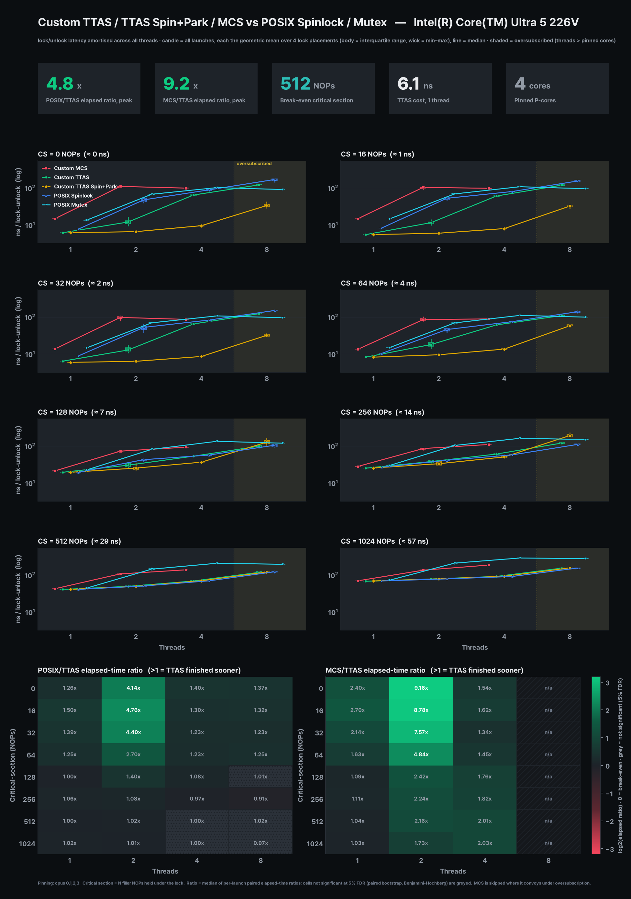

# Spinlock Implementation & Performance Test

This project provides custom spinlocks using architecture-specific inline assembly (x86-64 and aarch64) and compares them head-to-head with the POSIX spinlock (`pthread_spin_lock`) and the default POSIX mutex (`pthread_mutex_lock`). Three disciplines are exposed, each named for its algorithm and its wait policy: `spin_lock_ttas` (test-and-test-and-set with exponential backoff, pure spin), `spin_lock_ttas_park` (the same loop, but it sleeps 1 us per failed CAS once the backoff cap is reached) and `spin_lock_mcs` (an MCS queue lock, also usable with caller-supplied nodes). The benchmark allows granular control over threading, iteration counts, workload simulation, CPU pinning, timer slack, and which contenders run, via command-line arguments.

## Supported Platforms
- **Architecture**: x86-64 and aarch64. Each acquire/release primitive is emitted as architecture-specific inline assembly selected at compile time (`#if defined(__x86_64__)` / `__aarch64__`); any other target stops with a `#error`.
  - **x86-64**: `pause` spin hint, `lock cmpxchgl` acquire, and a plain store release — sufficient under the strong x86-TSO memory model. The TTAS backoff is timed with `rdtsc`, calibrated once against `CLOCK_MONOTONIC`.
  - **aarch64**: `yield` spin hint and an `stlr` store-release (a plain store is *not* a release on the weakly-ordered aarch64 memory model). The TTAS backoff is timed with the generic timer (`cntvct_el0`, frequency from `cntfrq_el0`). The acquire is chosen at compile time:
    - **v8.1 LSE** (`__ARM_FEATURE_ATOMICS` defined): a single-instruction `casa` (load-acquire compare-and-swap). With no exclusive monitor to lose, it has no retry loop and scales far better under heavy contention. Enabled when the toolchain targets an LSE-capable CPU (e.g. `-march=armv8.1-a` or `-march=armv8-a+lse`).
    - **Baseline v8.0** (`-march=armv8-a`, no LSE): an `ldaxr`/`stlxr` load-acquire exclusive CAS retry loop with `clrex` on mismatch — the portable fallback used when LSE is unavailable.
- **Lock disciplines** (all on x86-64 and aarch64; a NULL lock pointer faults, it is not silently ignored):
  - **`spin_lock_ttas`** / **`spin_unlock_ttas`** — test-and-test-and-set with exponential backoff between failed CAS attempts, timed in nanoseconds (`-m`..`-M`, default 32..1,024 ns); each wait is drawn from the upper half of the current window, so waiters do not retry in lockstep. Timing the wait keeps it the same on every core type: a pause costs 10.1 ns on a P-core and 21.9 ns on an E-core of the test host, so a cap counted in pauses would differ by 2.2x between them. Pure spin: a waiter never leaves the CPU. An uncontended acquire is a single CAS.
  - **`spin_lock_ttas_park`** — the same loop on the same `struct spinlock_ttas` (same init, same unlock), but once the backoff cap is reached every further failed CAS calls `nanosleep(1 us)`. Linux rounds that sleep up by the thread's timer slack (`/proc/self/timerslack_ns`, 50 us by default; real-time scheduling classes get zero slack), so a parked waiter is away for ~50 us while the holder re-acquires unopposed: throughput over fairness, and a policy the benchmark's `-S` flag makes visible.
  - **`spin_lock_mcs`** / **`spin_unlock_mcs`** — an MCS queue lock (tail swap via `xchg` / LSE `swpal` / LL-SC, hand-off via `stlr` / release store). Each waiter spins on its own cache line, so it is FIFO-fair and storm-free, at the cost of a cache-line transfer per hand-off; it convoys under oversubscription (a preempted successor stalls the whole queue). These single-argument wrappers use a per-thread node defined once in `spinlock.c` (`g_spin_mcs_thread_local_node`), so a lock taken in one translation unit may be released in another; they still must not nest, because one node can sit in only one queue at a time (the debug build aborts on a nested wrapper call). **`spin_lock_mcs_node(lock, node)`** / **`spin_unlock_mcs_node(lock, node)`** take an explicit, cache-line-aligned `struct mcs_node` and have neither limit:
    ```c
    struct spinlock_mcs lock; /* spin_init_mcs(&lock) once */
    struct mcs_node node; /* one per thread per held lock */
    spin_lock_mcs_node(&lock, &node);
    /* critical section */
    spin_unlock_mcs_node(&lock, &node);
    ```
- **Core types**: on parts with more than one core class (Intel P/E, Arm big.LITTLE) the harness pins workers to the fastest class unless `-C` says otherwise. It reads `cpu_capacity` (else `cpufreq/cpuinfo_max_freq`) for every allowed CPU, keeps those within 80% of the highest value, and fills one hardware thread per physical core first. Homogeneous parts are not pinned.
- **OS**: Linux
- **Compilers**: GCC or Clang (Standard: `gnu99`)
- **Build System**: CMake with Ninja Multi-Config presets, driven by `build.cmake` through `make`, `./build.sh` or `cmake -P build.cmake --`
- **Build Modes** (`cmake/flags.cmake`, shared with the other repositories that build with CMake; every mode adds `-Wall -Wextra -pedantic -Wshadow -Wformat -Werror=format-security` and this project's `-Wformat=2 -Wstrict-prototypes -Wmissing-prototypes -Wpointer-arith -Wcast-qual -Wwrite-strings -Wvla -Wundef -Wnull-dereference -Wimplicit-fallthrough -Wdouble-promotion -Wconversion -Wsign-conversion -Wno-unused-parameter`):
  - **Debug**: `-O0 -ggdb3 -fno-inline -fno-optimize-sibling-calls -fno-omit-frame-pointer -DSPINLOCK_DEBUG`, no default hardening, no PIE, `-rdynamic`, `-pg` — every `static inline` helper resolves to a real call frame so `uftrace`, `gdb`, `strace`, and `perf` can step into each function. `SPINLOCK_DEBUG` compiles in misuse checks that abort at the offending call.
  - **Sanitize**: Debug plus `-fsanitize=address` (or the list in `SANITIZE=`), `-fno-sanitize-recover=all` and `-ftls-model=local-exec`, which avoids a GCC 16 `-fsanitize=null` false positive when `undefined` is in the list (see [Validators](#validators)). Toolchains without sanitizer runtimes skip it with a note.
  - **Release**: `-O2 -g`, `-fstack-protector-strong -fstack-clash-protection -D_FORTIFY_SOURCE=3`, `-fcf-protection=full` or `-mbranch-protection=standard`, frame pointers, PIE, full RELRO and link-time optimization (LTO), as distributions ship.
- **Warnings**: no errors under either compiler. The check suite's lock callbacks share one signature, so the parameters each leaves unused carry no information: the build passes `-Wno-unused-parameter`. The only remaining warning is `-Wunused-function` on `report_skip` in `SPINLOCK_DEBUG` builds, which call it only without that macro. Nothing is silenced in the source (no `(void)` casts or unused attributes); every other warning is fixed.
- **Code Style**: the [c-programming coding style](https://github.com/yugeun-song/c-programming/blob/main/docs/coding-style.en.md). `.clang-format` holds its formatting part; naming, pointer parameters, explicit comparisons and the other rules are kept by hand. The contender table `gs_contenders` sits with the other file-scope variables, after forward declarations of the worker routines it points to.

## Build Instructions

Each program goes to `bin/<arch>-linux-<compiler>-<config>/`, so GCC, Clang and cross builds coexist. GCC is the default.

```bash
make                  # Debug and Sanitize (all); one Ninja job per CPU
make PROFILE=release  # Release instead; index, unused, tidy and clangd-check take its flags too
make release          # bin/<arch>-linux-<compiler>-release/{spinlock_test,spinlock_check}
make debug            # bin/<arch>-linux-<compiler>-debug/{spinlock_test,spinlock_check}
make sanitize         # the Sanitize build, address by default; make sanitize SANITIZE=address,undefined
make CC=clang         # the same with Clang; PRESET=<preset> picks any preset in CMakePresets.json
make check            # build every config the toolchain can link and run the tests in each
make index            # compile_commands.json with the PROFILE flags, tags and cscope.out in the root;
                      # later builds rewrite compile_commands.json when its flags change
make clean-index      # remove them again
make clangd-check     # let clangd parse every file and print its errors
make tidy             # clang-tidy over every translation unit with .clang-tidy
make unused           # unused diagnostics (clang) and unused functions (cppcheck)
make clean            # remove bin/ and the build products; configured trees stay configured
make distclean        # clean, the index, build/, caches and every debugger / profiler artifact
make help             # the goals, the variables and the presets this host can build
```

`./build.sh` and `cmake -P build.cmake --` take the same commands, a preset name, `PROFILE=` and `SANITIZE=`. Each command ends with a `=>` line that names what it produced, and configure reports the probed flags in the same form whenever they change. Several goals run one at a time in the given order, so `make clean all` is safe. `make all` never runs tests: concurrent stress tests oversubscribe the cores (three check binaries together ran past 120 s, versus 2–3 s alone). `make check` runs `spinlock_check` and a short benchmark whose atomic counts must all be OK, in Debug, Sanitize and Release.

### Editor integration: clangd, ctags, cscope

`make index` writes three files into the source root, all ignored by git:

- **`compile_commands.json`** — the Debug entry of every translation unit. clangd reads it and parses each `.c` file, and each header through the `.c` that includes it, as `gnu99` C for the compiler's target.
- **`tags`** — Universal Ctags over the tracked sources and headers.
- **`cscope.out`** (plus `cscope.files`, `cscope.in.out`, `cscope.po.out`) — built in kernel mode (`-k`) from the same file list, so it indexes the project and not `/usr/include`.

The checked-in **`.clangd`** only turns inlay hints off. Without it clangd already drops the GCC-only flags it does not know, keeps the include cleaner at its defaults (`UnusedIncludes: Strict`, `MissingIncludes: None`), and runs the checks in `.clang-tidy`.

### aarch64

On an aarch64 host the default preset is `aarch64-linux-gcc`. From an x86 host the aarch64 presets cross-build, and `make check` runs the tests under `qemu-aarch64`:

```bash
make PRESET=aarch64-linux-gcc release check
qemu-aarch64 -L /usr/aarch64-linux-gnu ./bin/aarch64-linux-gcc-release/spinlock_test -t 4 -l 0 -i 100000
```

The aarch64 build targets the v8.0 baseline (`-march=armv8-a`, LL/SC). To emit the single-instruction LSE atomics (`casa` acquire, `swpal`/`casl` for the MCS queue), configure the preset once with `ARCH_LSE` on; later builds keep it:

```bash
cmake --preset aarch64-linux-gcc -DARCH_LSE=ON && make PRESET=aarch64-linux-gcc release
```

A fully static binary (no sysroot needed to run under QEMU) can be built directly:

```bash
aarch64-linux-gnu-gcc -O2 -std=gnu99 -Wall -Wextra -static -march=armv8.1-a \
    spinlock.c spinlock_test.c main.c -o spinlock_test_arm64_lse -pthread
```

Confirm which path was compiled in by disassembling: `casa`/`swpal` means the LSE path, `ldaxr`/`stlxr` means the LL/SC fallback.

### Artifacts (in `bin/<arch>-linux-<compiler>-<config>/`)

| Folder | Programs | Built by |
| :--- | :--- | :--- |
| `…-release/` | `spinlock_test`, `spinlock_check` | `make release` |
| `…-debug/` | `spinlock_test`, `spinlock_check` | `make`, `make debug` |
| `…-sanitize/` | `spinlock_test`, `spinlock_check` | `make`, `make sanitize` |

- `…-release/spinlock_test` — **release build**, used for benchmarking and the headline numbers below.
- `…-debug/spinlock_test` — **debug build**, used with `uftrace`, `gdb`, `strace`, `perf`, and other analysis tools. Inlining is fully suppressed and `-rdynamic` exposes all symbols, so every helper appears as a real call frame.
- `…-release/spinlock_check` / `…-debug/spinlock_check` — the **correctness suite** (see [Stability & Sanity Checks](#stability--sanity-checks)) built with the release and the debug flags; `make check` runs both. `SPINLOCK_CHECK_ITERATIONS=<n>` shrinks the contended passes, for example under valgrind.
- `…-sanitize/spinlock_check` — the suite under AddressSanitizer, or the sanitizers in `SANITIZE=`, run by `make check`.

### Source layout
- `spinlock.h` — the three lock disciplines, header-only apart from the definitions below.
- `spinlock.c` — the backoff window (`g_conf_backoff_min_ns` / `g_conf_backoff_max_ns`, defaults `SPINLOCK_DEFAULT_BACKOFF_MIN_NS` / `SPINLOCK_DEFAULT_BACKOFF_MAX_NS`), the tick calibration (`spin_measure_ticks_per_ns_q16`, `spin_calibrate_backoff_clock`) and the thread-local MCS node behind the single-argument wrappers. Link it into every program that uses the header.
- `spinlock_test.h` / `spinlock_test.c` / `main.c` — the benchmark harness behind the `bench_*` API.
- `spinlock_check.c` — the correctness suite.

## Usage & Options

Run the binary directly from the command line. If no arguments are provided, default values are used. The examples use the release build of the default toolchain on x86-64; substitute your own `<arch>-linux-<compiler>` folder.

```bash
./bin/x86_64-linux-gcc-release/spinlock_test [options]
```

### Command-Line Arguments

| Option | Argument | Description | Default |
| :--- | :--- | :--- | :--- |
| `-t` | `<threads>` | **Thread Count**: Number of concurrent worker threads to spawn. | `4` |
| `-i` | `<iters>` | **Iterations**: Number of critical section entries per thread. | `1,000,000` |
| `-l` | `<loops>` | **Workload**: Number of `nop` loop iterations inside the critical section (simulates load). | ≈ 50 ns |
| `-o` | `<loops>` | **Outside work**: Number of `nop` loop iterations each thread runs after releasing the lock and before asking again, so the lock is contended as in real code rather than saturated. `0` is the saturated stress test that `test_bench.py` runs. | ≈ 150 ns |
| `-m` | `<ns>` | **Min Backoff**: First backoff window after a failed CAS, in nanoseconds. | `32` |
| `-M` | `<ns>` | **Max Backoff**: Cap of the doubling backoff window, in nanoseconds. `ttas_park` sleeps 1 us per failed CAS once the cap is reached. | `1,024` |
| `-C` | `<cpulist>` | **Pin**: Bind workers round-robin to these cores (e.g. `0-3` or `0,2,4`), or `none`. Without `-C`, P/E and big.LITTLE parts pin to the fastest core class (see [Supported Platforms](#supported-platforms)) and homogeneous parts run unpinned. | fastest core class |
| `-K` | `<locks>` | **Contenders**: Comma-separated subset of `ttas,ttas_park,pspin,pmutex,mcs`, run in the given order. Drop `mcs` at thread counts that oversubscribe the cores, where the queue lock convoys. | all five |
| `-S` | `<ns>` | **Timer slack**: `prctl(PR_SET_TIMERSLACK)` for the process before the workers start; it stretches every `nanosleep` of `ttas_park`. `0` restores the kernel default, the smallest value is `1`. The effective value is printed in the header. | inherited (50,000 ns) |
| `-F` | `<format>` | **Output**: `text`, or `csv` with one row per contender and page (what `test_bench.py` reads). | `text` |
| `-P` | `<pages>` | **Placement**: Run every contender once per listed page of a private pool (e.g. `0-3` or `2,0,2`, pages `0`–`63`). Each page holds the four locks and the shared counter at the same offsets, so the list sets their physical placement. | `0` |
| `-h` | N/A | **Help**: Display usage information and exit. | N/A |

The header prints the measured cost of one workload loop iteration (`NOP Cost`, taken at startup on the first pinned core after a 50 ms warm-up) and shows `-l` and `-o` in NOPs and nanoseconds. Both defaults are sized from that cost, so they mean the same time on any core. Each contender prints a **`Fairness`** line: the earliest and latest per-thread completion time measured from the start barrier, and their ratio (`min/max`; `1.00` means every thread finished together, a small value means one thread ran through while the others waited). A **`Switches`** line counts the workers' involuntary (preemption) and voluntary context switches, and a **`Placement`** line names the page. The process exits with status 1 if any contender's atomic count is wrong.

### Execution Examples

#### 1. Default Run
4 threads, 50 ns inside the lock and 150 ns outside it: heavy but not saturated contention. On P/E or big.LITTLE parts the workers run on the fastest core class.
```bash
./bin/x86_64-linux-gcc-release/spinlock_test
```

#### 2. High Contention Test
Saturate the lock: 8 threads, an empty critical section and no work outside the lock.
```bash
./bin/x86_64-linux-gcc-release/spinlock_test -t 8 -l 0 -o 0
```

#### 3. Long Critical Section Test
Simulate a scenario where the lock is held for a longer duration (10,000 nops), which narrows the gap between the spinlocks as raw acquire cost is amortized over the critical section.
```bash
./bin/x86_64-linux-gcc-release/spinlock_test -l 10000
```

#### 4. Tuning Backoff Algorithm
Set the backoff window in nanoseconds, here 64 ns doubling up to 4 us. The window is timed, so the same values hold on P-cores, E-cores and aarch64 cores.
```bash
./bin/x86_64-linux-gcc-release/spinlock_test -m 64 -M 4096
```

#### 5. Controlled Run (pinning + contender selection)
Pin explicitly (here the four P-cores, which is also the default on this host) and compare only the TTAS lock against POSIX (dropping the MCS queue lock):
```bash
./bin/x86_64-linux-gcc-release/spinlock_test -t 4 -C 0-3 -K ttas,pspin
```

#### 6. Timer Slack
Run the parking TTAS and the POSIX mutex with a 1 ns timer slack, so `nanosleep(1 us)` returns after ~2 us instead of ~50 us:
```bash
./bin/x86_64-linux-gcc-release/spinlock_test -t 4 -C 0-3 -l 0 -o 0 -S 1 -K ttas_park,pmutex
```

## Profiling & Tracing the Debug Build

The debug build (`./bin/x86_64-linux-gcc-debug/spinlock_test`) suppresses inlining and ships full debug info, so every `static inline` helper resolves to a real call frame. Common workflows:

```bash
# Function-level user-space trace (uftrace)
uftrace ./bin/x86_64-linux-gcc-debug/spinlock_test -t 8 -l 0 -i 100000

# Hot-path sampling with perf (DWARF call graph)
perf record -F 999 --call-graph dwarf ./bin/x86_64-linux-gcc-debug/spinlock_test -t 8 -l 0 -i 100000
perf report

# Single-step into spin_lock_ttas under gdb
gdb -ex 'b spin_lock_ttas' --args ./bin/x86_64-linux-gcc-debug/spinlock_test -t 2 -l 0 -i 1000

# Syscall summary
strace -c ./bin/x86_64-linux-gcc-debug/spinlock_test -t 4 -l 0 -i 100000

# Valgrind: memory errors, thread races, cache profile
valgrind --tool=memcheck --leak-check=full ./bin/x86_64-linux-gcc-debug/spinlock_test -t 2 -l 0 -i 1000
valgrind --tool=helgrind                    ./bin/x86_64-linux-gcc-debug/spinlock_test -t 4 -l 0 -i 1000
valgrind --tool=drd                         ./bin/x86_64-linux-gcc-debug/spinlock_test -t 4 -l 0 -i 1000
valgrind --tool=cachegrind                  ./bin/x86_64-linux-gcc-debug/spinlock_test -t 2 -l 500 -i 10000
```

All commands above run unchanged on an aarch64 host. To drive a cross-built aarch64 binary from an x86 host, wrap it in QEMU's gdbstub and attach the cross debugger:

```bash
make CC=aarch64-linux-gnu-gcc debug
qemu-aarch64 -L /usr/aarch64-linux-gnu -g 1234 ./bin/aarch64-linux-gcc-debug/spinlock_test -t 2 -l 0 -i 1000 &
aarch64-linux-gnu-gdb -ex 'set sysroot /usr/aarch64-linux-gnu' -ex 'target remote :1234' \
    -ex 'b spin_lock_ttas' ./bin/aarch64-linux-gcc-debug/spinlock_test
```

Use `make distclean` to scrub every debugger / profiler / tracer artifact (cores, valgrind dumps, perf.data, uftrace.data, `__pycache__`, CMake residue, …) on top of `make clean`'s build-only sweep.

The release build (`./bin/<arch>-linux-gcc-release/spinlock_test`, or whatever `--binary` names) is what `test_bench.py` exercises and what produces the headline numbers below.

## Benchmark Results
*Test environment: Intel Core Ultra 5 226V (4 P-cores @ 4.5 GHz + 4 E-cores @ 3.5 GHz), Arch Linux, kernel `7.2.15-arch1-1`, GCC 16.2.1 release build (`-O2`), default timer slack 50,000 ns (`/proc/self/timerslack_ns`). Workers pinned to the four P-cores (`-C 0-3`). Each number is the median over 5 launches (3 for the longer critical section), each launch the geometric mean of 4 placement pages (`-P 0-3`), 1,000,000 iterations per thread and `-o 0` unless stated, with the lock order shuffled per launch. `ns/acq` is elapsed time divided by the total number of acquisitions, and `min/max` is the median ratio of the earliest to the latest thread completion. The measured NOP cost is 0.056 ns: GCC 16 at `-O2` unrolls the filler loop to two NOPs per iteration, and a P-core retires four NOPs per cycle.*

**What the harness rewards.** Each thread performs a fixed number of acquisitions and the elapsed time is the wall time until the *last* thread finishes; there is no fairness term. On the same four cores a contended hand-off costs every lock about the same, because the lock word (or the MCS flag) has to move between cores: ≈ 90–105 ns per acquisition here for the POSIX spinlock, the POSIX mutex and MCS. A lock that finishes several times sooner is doing different work: its waiters stay away from the lock while one thread re-acquires uncontended at ≈ 10 ns. The `min/max` column shows only whether the threads finished together (`1.00`) or one ran through while the others waited (`0.4–0.7`); it does not show how often the lock changed hands. A build that counts owner changes inside the critical section (one extra load and compare per acquisition, 12 runs per cell on the P-cores, 2–8 threads) shows that directly. Saturated, MCS hands over on 98–100% of acquisitions, the mutex on 24–76%, `pthread_spin_lock` on up to 23%, `ttas` on up to 13% and `ttas_park` on under 1%; with 50 ns inside the lock and nothing outside, the three spinlocks keep the lock on one thread for all but a handful of acquisitions. With 150 ns of work outside the lock every lock hands over on 90–100%.

### Default run (`-t 4`: ≈ 50 ns inside the lock, ≈ 150 ns outside it)

| Lock | Elapsed (ms) | ns/acq | min/max |
| :--- | ---: | ---: | ---: |
| `ttas` | 761.2 | 190.3 | 0.92 |
| `ttas_park` | 698.8 | 174.7 | 0.83 |
| `pspin` | 921.4 | 230.4 | 0.96 |
| `pmutex` | 1,190.1 | 297.5 | 0.97 |
| `mcs` | 663.7 | 165.9 | 1.00 |

With work outside the lock the lock is busy most of the time but not saturated, so the hand-off decides. MCS is fastest: each release passes the lock to one known waiter. `ttas` is 1.21x ahead of `pthread_spin_lock` at similar fairness, `ttas_park` gains by parking waiters, and the mutex pays a futex wake per contended hand-off.

### 4 threads, empty critical section (`-t 4 -l 0 -o 0`)

| Lock | Elapsed (ms) | ns/acq | min/max |
| :--- | ---: | ---: | ---: |
| `ttas` (timed backoff, 32–1,024 ns) | 271.7 | 67.9 | 0.93 |
| `ttas_park` (spin, then 1 us park) | 38.8 | 9.7 | 0.66 |
| `pspin` (`pthread_spin_lock`) | 364.3 | 91.1 | 0.63 |
| `pmutex` (`pthread_mutex_lock`) | 413.0 | 103.2 | 0.94 |
| `mcs` | 396.7 | 99.2 | 1.00 |

`ttas` finishes its threads together (0.93) and 1.3x sooner than `pthread_spin_lock`, but it changes owner on only 12% of acquisitions against 22% for `pthread_spin_lock`, so part of that lead is longer runs of one thread rather than cheaper hand-offs. The like-for-like comparison is the default run above, where every lock hands over on nearly every acquisition and `ttas` is still ahead. `ttas_park` is 7x faster than `ttas` only because its waiters sleep ≈ 50 us while one thread runs through (0.66).

### Timer slack (`-S`)

`ttas_park` sleeps 1 us per failed CAS once the backoff cap is reached, and Linux rounds `nanosleep` up by the timer slack. Note that `prctl(PR_SET_TIMERSLACK, 0)` *restores the kernel default* (the header shows `Timer Slack : 50000 ns` for `-S 0`); `-S 1` is the smallest slack, and real-time scheduling classes get zero slack without any flag.

| `-t 4 -l 0 -o 0`, lock | slack 50,000 ns | slack 1,000 ns | slack 1 ns |
| :--- | ---: | ---: | ---: |
| `ttas_park` elapsed (ms) / min/max | 37.4 / 0.59 | 103.7 / 0.81 | 128.0 / 0.84 |
| `ttas` elapsed (ms) / min/max (no sleep, reference) | 264.6 / 0.93 | 261.9 / 0.92 | 270.9 / 0.94 |

With the 1 us backoff cap the park is the whole wait, and the slack sets its length: over 2,000 samples on a P-core, `nanosleep(1 us)` returns after a median of 52.3 us at the default slack, 3.3 us at `-S 1000` and 1.9 us at `-S 1`. Shortening it brings the parked waiters back sooner, and `ttas_park` goes from 37.4 ms to 128.0 ms (3.4x) with no code change, while the pure-spin `ttas` stays at ≈ 265 ms. A `ttas_park` result is therefore a property of the kernel's timer slack as much as of the lock; report `-S` (or the header's `Timer Slack`) with it.

### Backoff cap (`-M`, 4 threads, empty critical section)

| `-M` (ns) | `ttas` elapsed (ms) / ns/acq / min/max | `ttas_park` elapsed (ms) / min/max | `pspin` elapsed (ms) / min/max |
| :--- | ---: | ---: | ---: |
| 256 | 312.2 / 78.1 / 0.93 | 33.1 / 0.73 | 347.3 / 0.65 |
| 1,024 (default) | 261.2 / 65.3 / 0.91 | 36.9 / 0.59 | 355.7 / 0.62 |
| 8,192 | 85.5 / 21.4 / 0.61 | 40.1 / 0.59 | 361.9 / 0.64 |
| 65,536 | 41.3 / 10.3 / 0.50 | 40.2 / 0.40 | 337.2 / 0.54 |
| 167,000 | 38.9 / 9.7 / 0.47 | 38.3 / 0.48 | 368.1 / 0.63 |

Up to a microsecond `ttas` finishes its threads together and beats `pthread_spin_lock`; from ≈ 8 us it becomes a serialiser, several times "faster" at min/max 0.5–0.6. The previous default, 16,000 pauses (≈ 167 us on a P-core, ≈ 351 us on an E-core), sat at that end. In the sweep below the 1 us cap is 3% and 9% behind `pthread_spin_lock` at 256 NOPs with 4 and 8 threads and ahead of it or level everywhere else.

### Oversubscription on the four P-cores (`-t 8` and `-t 16`, `-l 0 -o 0`)

| Lock | 8 threads: elapsed (ms) | ns/acq | min/max | 16 threads: elapsed (ms) | ns/acq | min/max |
| :--- | ---: | ---: | ---: | ---: | ---: | ---: |
| `ttas` | 977.7 | 122.2 | 0.92 | 3,692.0 | 230.7 | 0.87 |
| `ttas_park` | 239.2 | 29.9 | 0.65 | 7,265.5 | 454.1 | 0.72 |
| `pspin` | 1,452.0 | 181.5 | 0.57 | 5,343.8 | 334.0 | 0.56 |
| `pmutex` | 728.1 | 91.0 | 0.95 | 1,583.7 | 99.0 | 0.90 |
| `mcs` (10,000 / 5,000 iterations per thread) | 52,944 | 661,794 | 0.98 | 131,773 | 1,647,162 | 0.52 |

Once threads outnumber cores the lock holder gets preempted. The POSIX spinlock's waiters spin through their whole timeslice (182 → 334 ns/acq); the mutex parks them in the kernel and stays at ≈ 90–100 ns/acq. `ttas` stays fair and ahead of `pspin` but behind the mutex. `ttas_park` is the fastest at 8 threads and, MCS aside, the slowest at 16. MCS collapses: a preempted successor stalls the whole queue for a scheduler quantum, ≈ 0.7 ms per acquisition at 8 threads and 1.6 ms at 16 (one launch, one page each), which is why the sweep drops it above the core budget.

### A longer critical section (`-t 4 -l 4096 -o 0`, ≈ 0.23 us held)

| Lock | 1 thread (ms) | 4 threads (ms) | min/max |
| :--- | ---: | ---: | ---: |
| `ttas` | 239.1 | 1,134.6 | 0.42 |
| `ttas_park` | 248.0 | 1,168.8 | 0.44 |
| `pspin` | 240.5 | 1,128.9 | 0.40 |
| `pmutex` | 243.6 | 2,450.6 | 0.95 |
| `mcs` | 242.0 | 1,794.9 | 1.00 |

The critical section dominates: 4 × 239 ms = 956 ms of serialised work is the floor. The three spinlocks land 18–22% above it and their ordering is gone (`ttas`/`pspin` = 1.01x). MCS adds ≈ 210 ns per hand-off, the mutex ≈ 374 ns: with a 0.23 us hold every acquisition is contended, so every mutex hand-off goes through a futex wake. The spinlocks' min/max stays at ≈ 0.4 because a released lock goes to whichever waiter sees it first.

### Uncontended cost (`-t 1 -l 0 -o 0`, ns per lock/unlock pair)

`ttas` 6.0 · `ttas_park` 6.1 · `pspin` 7.6 · `pmutex` 13.2 · `mcs` 14.5. Single-threaded, the custom TTAS lock is 1.6 ns ahead of `pthread_spin_lock`. The two use the same test-and-test-and-set loop (glibc's has no backoff), but `pthread_spin_lock` and `pthread_spin_unlock` are two calls into libc through the PLT per acquisition, while the custom locks are inlined into the loop.

### Core types and contention levels

*Each cell: 7 launches × 4 pages, 300,000 iterations per thread, workers pinned to the listed CPUs (the mixed set alternates P- and E-cores), the 45 cells run in shuffled order. Work inside and outside the lock is sized in nanoseconds with each class's NOP cost (0.0557 ns on a P-core, 0.1432 ns on an E-core); the mixed set uses the P-core size, so the same work takes 2.6x longer on its E-cores. Ratios are paired per launch, and **bold** marks a ratio significant at a 5% false discovery rate over all 45 cells (paired bootstrap, Benjamini–Hochberg).*

`pspin`/`ttas` elapsed-time ratio (>1 = `ttas` finished sooner):

| Inside / outside the lock (ns) | P-cores 0-3, 2 thr | P-cores 0-3, 4 thr | P-cores 0-3, 8 thr | E-cores 4-7, 2 thr | E-cores 4-7, 4 thr | E-cores 4-7, 8 thr | P and E mixed, 2 thr | P and E mixed, 4 thr | P and E mixed, 8 thr |
| :--- | ---: | ---: | ---: | ---: | ---: | ---: | ---: | ---: | ---: |
| 0 / 0 (saturated) | **4.73x** | **1.29x** | **1.47x** | 1.09x | **1.30x** | **1.38x** | **1.37x** | 0.99x | 1.00x |
| 50 / 0 (saturated) | **1.03x** | **1.01x** | **1.02x** | **1.03x** | **1.03x** | **1.04x** | 0.96x | 1.04x | 1.06x |
| 50 / 150 (default) | **1.04x** | **1.22x** | **1.25x** | **1.01x** | **1.10x** | **1.14x** | **0.94x** | **1.13x** | 1.02x |
| 50 / 1,000 | **1.06x** | **1.07x** | **1.15x** | **1.00x** | **1.00x** | **1.05x** | **0.99x** | **1.01x** | **1.17x** |
| 200 / 600 | **1.01x** | **1.10x** | **1.09x** | **1.00x** | **1.00x** | **1.04x** | **0.99x** | 1.03x | **0.96x** |

Fastest lock (two names = not significantly apart, 5% false discovery rate over 45 cells):

| Inside / outside the lock (ns) | P-cores 0-3, 2 thr | P-cores 0-3, 4 thr | P-cores 0-3, 8 thr | E-cores 4-7, 2 thr | E-cores 4-7, 4 thr | E-cores 4-7, 8 thr | P and E mixed, 2 thr | P and E mixed, 4 thr | P and E mixed, 8 thr |
| :--- | ---: | ---: | ---: | ---: | ---: | ---: | ---: | ---: | ---: |
| 0 / 0 (saturated) | `ttas_park` | `ttas_park` | `ttas_park` | `ttas_park` | `ttas_park` | `ttas_park` | `ttas_park` | `ttas_park` | `ttas_park` |
| 50 / 0 (saturated) | `ttas` = `ttas_park` | `ttas` = `ttas_park` | `ttas` | `ttas` | `ttas_park` = `ttas` | `ttas_park` = `ttas` | `pspin` = `ttas_park` | `ttas_park` = `ttas` | `ttas` = `ttas_park` |
| 50 / 150 (default) | `ttas` | `mcs` | `pmutex` = `ttas` | `ttas` = `ttas_park` | `ttas_park` | `ttas` | `pspin` | `ttas_park` | `ttas_park` |
| 50 / 1,000 | `ttas` | `ttas` | `pmutex` | `ttas_park` = `ttas` | `ttas` | `pmutex` | `pspin` | `mcs` | `ttas` |
| 200 / 600 | `ttas` | `ttas` | `ttas` | `ttas_park` | `ttas` = `ttas_park` | `pmutex` | `pspin` | `ttas` = `pspin` | `ttas_park` |

Each cell is a direct harness run, `-C <cpus> -t <threads> -l <nops> -o <nops> -i 300000 -P 0-3`.

- **One class of fast cores** (what the default pinning picks): `ttas` finished significantly sooner than `pthread_spin_lock` in all 15 P-core cells: by 1–15% with work in or outside the lock, by 22–25% at the default load with 4 and 8 threads, and by 1.3–4.7x on the saturated empty critical section.
- **E-cores only**: these share one L2 and have no L3 on this part, so a hand-off is cheaper: MCS, which hands over on nearly every acquisition, takes 44–87 ns per acquisition on the saturated empty critical section against 100–110 ns on the P-cores. `ttas` is ahead of `pthread_spin_lock` or level in every cell, by 30–38% on the saturated empty critical section and by 10–14% at the default load, both with 4 and 8 threads.
- **P- and E-cores mixed**: neither spinlock wins throughout. With 2 threads `pthread_spin_lock` finished sooner whenever there was work outside the lock (by 1–6%, and by 5% in a separate 9-launch replication of the default load); with 4 threads `ttas` did at the default load (13%); with 8 threads the winner flips between 1 us outside the lock (`ttas`, 17%) and 200 / 600 ns (`pthread_spin_lock`, 4%), and the default load is level (1.02x here, 1.03x in the replication). Keep the workers on one core class, as the default pinning does.
- **No lock wins everywhere**: `ttas_park` wins every saturated empty critical section by parking its waiters, MCS wins the default load on 4 P-cores and 1 us of outside work on 4 mixed cores, and the mutex wins with 8 threads on 4 P- or E-cores once the work outside the lock reaches 1 us (on the E-cores also at 200 / 600 ns).

## Automated Benchmarking & Visualization

Measurement and visualization are split into two scripts, so the plot can be iterated on without touching benchmark code:

- **`test_bench.py`** runs the sweep — thread counts × workload intensities × the five contenders, aggregated as **Median ± median absolute deviation (MAD)** over **7 launches per cell, up to 14 where the robust coefficient of variation (CV) exceeds 5%**; each launch runs every lock on 4 pages (`-P 0-3`) and contributes their geometric mean — and writes the raw CSV of every measurement (`bench_results.csv`), a run-context sidecar (`bench_meta.json`, with the NOP cost, timer slack, seed and runnable-task counts), and a textual report. Launches run in a shuffled order, each with a shuffled lock order, after 3 discarded warmup launches; a launch is rejected when the harness exits non-zero or reports a wrong atomic count. The CSV keeps each run's launch index, page, lock position, context switches and the number of other runnable tasks at launch. Every launch is saturated (`-o 0`). To control variance it picks the fastest core class with the harness's rule (the P-cores on a P/E or big.LITTLE machine) and pins every worker to it via `-C`, sizing the thread sweep to that set; `--no-pin` disables it. It runs `bin/<arch>-linux-gcc-release/spinlock_test`; `--binary` selects another build, such as the Clang one. When the sweep finishes it hands off to the visualizer.
- **`plot.py`** renders the dashboard (`bench_result.png`) from the committed CSV alone. Run `python3 plot.py` to redraw after editing the plot, or `python3 test_bench.py --plot-only` for the same thing — both read the CSV and never modify it.

The dashboard is a dark board (Binance-style design-system palette):

- A **KPI strip** of headline numbers — the largest POSIX/TTAS and MCS/TTAS elapsed-time ratios (a serialisation effect at short critical sections, see above), the break-even critical-section size, TTAS's single-thread cost, and the pinned core count.
- **Eight scaling panels** (one per critical-section size, titled with its size in NOPs and in nanoseconds from the measured NOP cost), each plotting **nanoseconds per lock/unlock vs thread count** on a shared log axis. Each lock is a coloured line through its **median**, with its **launches as a candle** (body = interquartile range, wicks = min/max, locks offset side by side) to show run-to-run spread; the region where threads exceed the pinned cores is shaded **oversubscribed** (it degrades every lock, not just MCS). Latency is amortised across all threads (elapsed ÷ total ops), so a rising line is genuine contention overhead rather than just more work retired — it is the same measurement the results table reports as ms per 1M per-thread ops, divided by the thread count. Read it together with the harness's fairness line: amortised latency rewards a lock that lets one thread run through while the others wait.
- **Two elapsed-time ratio heatmaps** (POSIX/TTAS and MCS/TTAS) over critical-section × threads, sharing one colour scale so the two are directly comparable. Colour is `log2(ratio)` diverging around break-even (green = TTAS finished sooner, red = later, per the trading up/down semantic); each ratio is the median of per-launch paired ratios, and cells **not significant at a 5% false discovery rate** (paired bootstrap, Benjamini–Hochberg) are greyed instead of being painted as a decisive winner, and MCS's oversubscribed column is hatched `n/a`.

**Why the MCS line stops at the pinned core count.** MCS is a *strict FIFO queue* lock, so under oversubscription (more threads than pinned cores) it **convoys**: when the scheduler preempts the thread whose turn it is, every thread queued behind it stalls until that one successor is rescheduled again, and wall-clock time explodes (≈ 0.7 ms per acquisition at 8 threads on 4 cores here, versus ≈ 0.1 us subscribed), often to a timeout that would also starve the other contenders' samples. Test-and-set locks (TTAS, `pthread_spin_lock`) degrade under oversubscription but do not collapse this way. The sweep therefore drops MCS for thread counts above the pinned core budget (`run_mcs = t <= core_budget` in `test_bench.py`) rather than let a convoyed, timeout-dominated cell distort the comparison; on the machine below (4 pinned P-cores) that means MCS is measured at 1/2/4 threads and shown as `n/a` at 8. It is not a zero and not a win — and because the whole 8-thread column is oversubscribed for *every* lock, that regime is shaded so the caveat attaches to all five.

The lock colours follow the trading-semantics palette — **TTAS** green (up), **MCS** red (down), **POSIX spinlock** blue (info) — extended with **TTAS Spin+Park** amber and **POSIX mutex** cyan, each with a distinct marker, so the series stay separable under colour-vision deficiency and after the image is downscaled (thin marks that vanish on GitHub's down-sampling are avoided by construction). Type is set in Pretendard.

The critical section is emulated with N filler NOPs; the harness measures the cost of that loop at startup and prints it as `NOP Cost` (≈ 0.056 ns/NOP on this CPU's P-cores with the `-O2` build), which the report and the plot use to label sizes in nanoseconds. The workload range is a powers-of-two sweep, deliberately dense in the regime where a spinlock is the right tool — small, fast updates to shared state: `0` (pure lock contention, no CS), `16`/`32`/`64` (≈ 1–4 ns: a flag flip, a pointer swap, a couple of struct fields), `128`/`256` (≈ 7–14 ns: a small struct), `512` (≈ 29 ns), and `1,024` (≈ 57 ns, a medium CS shown for context). Heavier critical sections are intentionally omitted: holding a busy-wait spinlock that long is the wrong design, so benchmarking it would not inform a real spinlock choice.

**Measurement isolation.** To keep external interference out of each measurement, every benchmark process pins its workers to a homogeneous core set (see above), locks its resident pages into RAM (`mlockall(MCL_CURRENT)`, best-effort), warms every contender, and inserts a quiescent settle gap both between consecutive in-process lock measurements (`SETTLE_DELAY_MS`, default 100 ms) and between consecutive process launches (`SETTLE_SEC`, default 0.3 s) so one run cannot bias the next. Elapsed time comes from the workers' own timestamps (first start to last finish), so the main thread's wake-up and join latency stay out of it. In the latest sweep a run's position in its launch and the launch's place in the sweep do not move its time (Spearman ρ +0.01 and −0.03 on average over 152 cells), and a run's involuntary context switches only weakly (ρ ≈ +0.1). Most of the remaining spread comes from placement: the page that holds the locks and the counter maps to one of this CPU's four L3 slices, and in a dedicated experiment (run with the earlier `-O3` build) the slice, identified with uncore counters, moved a lock's time by up to 28% and explained 57–97% of the page-to-page variance in five of six tested cells. Each launch therefore measures every lock on four pages.

The full raw measurement table (8 workloads × 4 thread counts × 5 locks — Custom TTAS, Custom TTAS Spin+Park, Custom MCS, POSIX spinlock and POSIX mutex — × 7–14 launches × 4 pages, with MCS omitted at the oversubscribed 8-thread point) is shipped as [`bench_results.csv`](bench_results.csv) for downstream analysis.



## Stability & Sanity Checks

### Correctness suite (`make check`)

`spinlock_check.c` tests the locks with oracles that hold no matter what the tooling can see. Every contended pass runs up to 8 worker threads (bounded by the online CPU count) for 100,000 acquisitions each and checks three things after the threads join: an **overlap detector** (an `__atomic` counter incremented on entry to the critical section and decremented on exit, independent of the lock under test) recorded zero moments with two threads inside, the **protected counter** equals threads × iterations, and the lock's own word is back in its idle state (`is_locked == 0`, `queue_tail == NULL`). The detector is first run against a deliberately broken no-op lock and must report violations, so it is shown to be able to fail before it is trusted. The suite covers:

- `ttas` and `ttas_park` under contention, the latter with the backoff cap forced to 8 so every waiter really parks;
- the MCS single-argument wrapper, the explicit-node API with a heap node per thread, and two MCS locks nested per thread through two nodes;
- uncontended state transitions of every API (`is_locked` toggles, `queue_tail` points at the holder's node and returns to `NULL`, a failed CAS leaves the word untouched), the cache-line size and alignment of every type including the thread-local node, that the wrapper node is really per thread (a second thread queues behind it instead of sharing it), and that the backoff loop survives caps of `1`, `INT_MAX`, and a minimum above the maximum;
- in the debug build, that each `SPINLOCK_DEBUG` misuse check aborts the process (each case runs in a forked child and must end with `SIGABRT`).

Both check binaries pass on x86-64 with GCC and Clang, and both pass under `qemu-aarch64` for the v8.0 LL/SC build (`-march=armv8-a`) and the v8.1 LSE build (`-march=armv8.1-a`).

### Validators

The debug build (`./bin/x86_64-linux-gcc-debug/spinlock_test`) and the check suite were exercised under several validators (all five contenders selected):

| Tool | Scope | Result |
| :--- | :--- | :--- |
| **Stress matrix** (5 thread × 3 workload × 2 iter × 5 lock = 150 runs, `-C 0-3`) | atomic-count correctness | **150/150 OK** |
| **valgrind memcheck** (`--leak-check=full`, benchmark and check suite) | memory errors / leaks | **0 errors** |
| **valgrind drd** | data races | **0 errors** |
| **valgrind helgrind** | data races | 60 errors / 10 contexts (false positives, custom locks only); **0 errors** with `-K pspin,pmutex` |
| **AddressSanitizer + UBSan** (`make check SANITIZE=address,undefined`, GCC and Clang) | memory + UB | **clean, 16/16 checks pass** |
| **ThreadSanitizer** (`-fsanitize=thread`) | data races | a few warnings, count varies run to run (false positives, custom locks only), atomic count OK |

One tool finding was itself a false positive and is documented rather than worked around in the code: GCC 16's `-fsanitize=null` reports `member access within null pointer` for the extern thread-local MCS node when the code is compiled at `-O1` with the initial-exec or dynamic TLS models. The address is non-null at run time (checked in gdb: the handler is called with a literal `0` while `&g_spin_mcs_thread_local_node` reads a valid address), the report vanishes at `-O0`, under Clang, and with `-ftls-model=local-exec`. `make sanitize` therefore builds with `-ftls-model=local-exec`, which is the correct model for an executable that defines all of its own thread-locals.

The helgrind / TSan warnings are **expected**: both detectors only recognise synchronization expressed through `pthread` primitives or C11 `<stdatomic.h>`, and our spinlocks acquire through raw atomic instructions (TTAS: `lock cmpxchgl` on x86-64; an `ldaxr`/`stlxr` load-acquire CAS — or a single `casa` load-acquire CAS under v8.1 LSE — with an `stlr` release on aarch64. MCS: `xchg`/`lock cmpxchg` on x86-64; `swpal`/`casl` under LSE or `ldaxr`/`stlxr` LL/SC, with `ldar`/`stlr` hand-off, on aarch64) over `volatile`-qualified words, which they cannot pattern-match; every flagged stack is in `ttas_acquire`, `spin_unlock_ttas` or the MCS task, none in the `pspin`/`pmutex` contenders. `drd` ignores them because of how it tracks vector clocks per memory access. None of the tools reported a memory error and every run produced the expected atomic count. A NULL lock pointer is not checked: `spin_lock_ttas(NULL)` and the other four entry points fault with `SIGSEGV`. The debug build's `SPINLOCK_DEBUG` checks catch the other misuse class, releasing a lock that is not held and nesting the MCS wrapper, by aborting at the call site.

The results above are from the x86-64 build. On aarch64, correctness is established by construction: for **all three** lock disciplines every acquire/release path is confirmed by per-function disassembly (`ttas_try_acquire`: `casa` under `-march=armv8.1-a`, `ldaxr`/`stlxr`/`clrex` on baseline `-march=armv8-a`; `mcs_swap_queue_tail`: `swpal` / `ldaxr`+`stlxr`; `mcs_try_reset_queue_tail`: `casl` / `ldxr`+`stlxr`; releases via `stlr`, acquires via `ldar`), both builds compile without errors at `-O2` and `-O0`, and the atomic-count oracle passes under QEMU (`qemu-aarch64`) for both builds and all five contenders at 4 and 8 threads, with and without `-S`. Note that QEMU-user does not reproduce weak-memory reordering, so the guarantee rests on the architecturally-correct acquire/release barriers rather than on the emulator.
